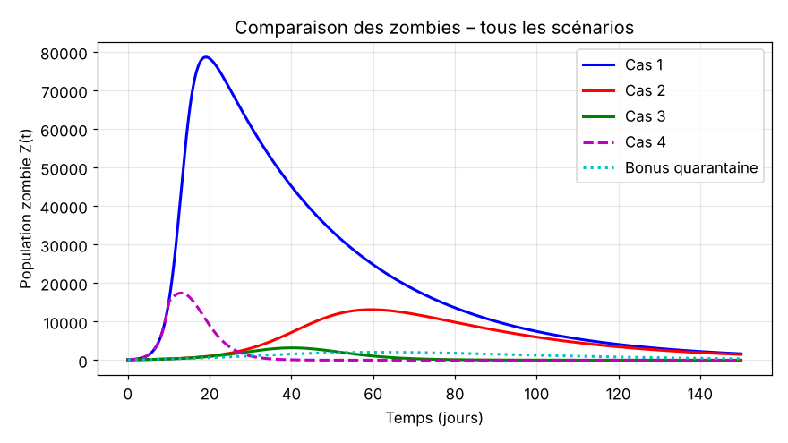
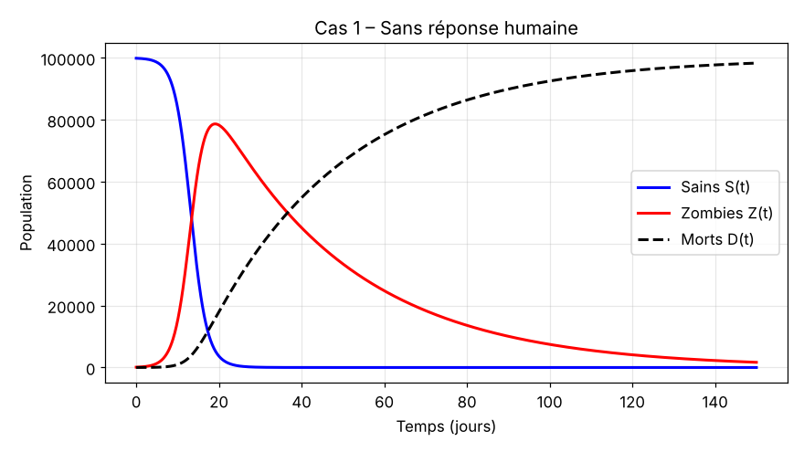
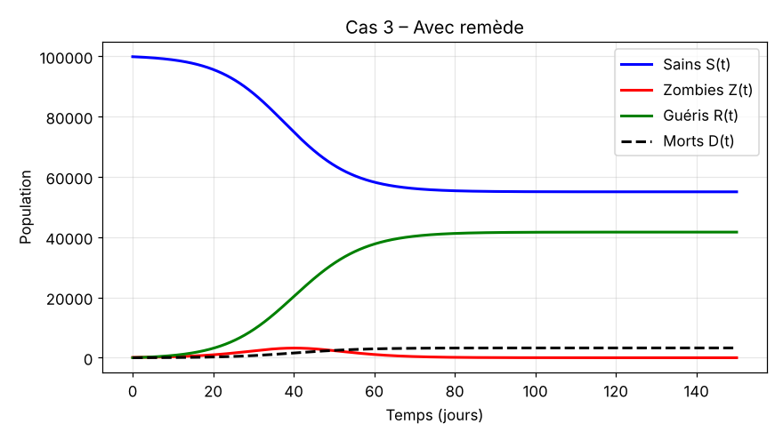
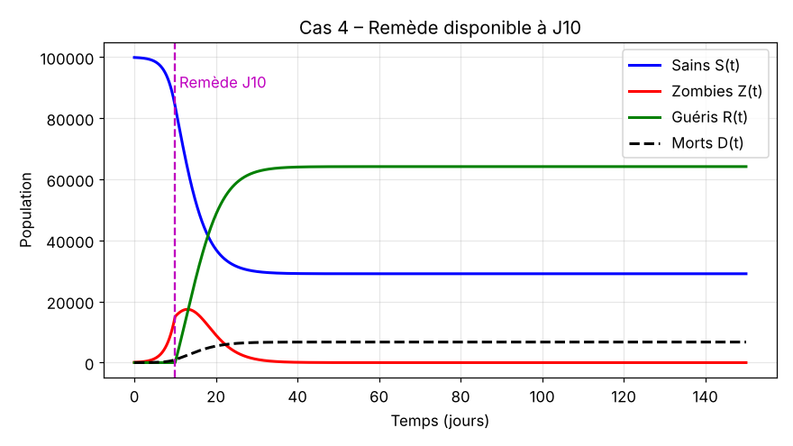
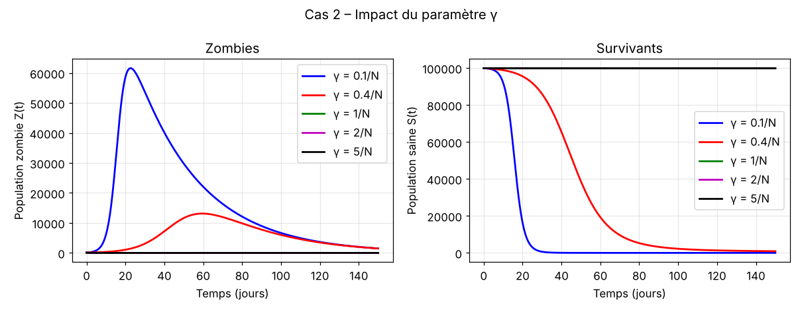

# Pandémie zombie — modélisation par équations différentielles

Simulation en **MATLAB** de la propagation d'une épidémie dans une population de 100 000 personnes, à partir d'une variante du **modèle compartimental SIR**. Cinq scénarios sont comparés : aucune réaction, rébellion humaine, remède immédiat, remède différé et mise en quarantaine.

Projet réalisé en **Bachelor 1 à l'IPSA** (cours d'introduction à MATLAB), en binôme.

---

## Le problème

Une épidémie zombie touche la ville de Lyon. L'objectif est de prévoir son évolution sur 150 jours et de mesurer l'effet de chaque stratégie de réponse (combat, remède, délai de mise à disposition du remède, quarantaine) sur le nombre de survivants.

Le sujet est volontairement ludique, mais la méthode est celle utilisée en épidémiologie et, plus largement, pour tout système dynamique : mise en équations, résolution numérique, étude de sensibilité aux paramètres.

## Le modèle

La population est répartie en compartiments : **S** (sains), **Z** (zombies), **D** (morts), puis **R** (guéris) et **Q** (quarantaine) selon les scénarios. Les échanges entre compartiments sont décrits par un système d'équations différentielles couplées, résolu avec `ode45` (Runge-Kutta d'ordre 4/5).

| Paramètre | Valeur | Rôle |
|---|---|---|
| N | 100 000 | Population totale |
| Z₀ | 100 | Zombies à t = 0 |
| α | 0,55 / N | Taux de contamination |
| β | 0,03 | Taux de mortalité des zombies |
| γ | 0,4 / N | Taux de victoire humaine / de guérison |
| ρ | 0,02 | Taux de mise en quarantaine (bonus) |

| Scénario | Équations |
|---|---|
| **Cas 1 – Sans réponse** | dS/dt = −αSZ · dZ/dt = αSZ − βZ · dD/dt = βZ |
| **Cas 2 – Rébellion** | dZ/dt = αSZ − βZ − γSZ · dD/dt = βZ + γSZ |
| **Cas 3 – Remède** | dZ/dt = αSZ − βZ − γ(S+R)Z · dR/dt = γ(S+R)Z |
| **Cas 4 – Remède à J10** | Cas 1 de J0 à J10, puis cas 3 de J10 à J150 (raccord des conditions initiales) |
| **Bonus – Quarantaine** | dS/dt = −αSZ − ρS · dQ/dt = ρS |

## Résultats

| Scénario | Pic de zombies | Survivants à J150 | Morts |
|---|---|---|---|
| Cas 1 – Sans réponse | ~78 700 | 0 | ~98 300 |
| Cas 2 – Rébellion (γ = 0,4/N) | ~13 100 | ~900 | ~97 600 |
| Cas 3 – Remède immédiat | ~3 200 | ~96 700 (dont ~41 700 guéris) | ~3 250 |
| Cas 4 – Remède à J10 | ~17 400 | ~93 300 | ~6 700 |
| Bonus – Quarantaine | ~2 100 | ~79 500 (sains + isolés) | ~20 100 |

| Cas 1 – Sans réponse humaine | Cas 3 – Remède immédiat |
|---|---|
|  |  |

**Remède différé :** dix jours de propagation libre multiplient le pic de zombies par cinq et doublent le nombre de morts par rapport au remède immédiat.

**Étude de sensibilité sur γ :** le comportement bascule autour de γ ≈ α. Tant que γ < α, l'épidémie suit presque la trajectoire du cas 1. Dès que γ > α, chaque rencontre élimine plus de zombies qu'elle n'en crée et l'épidémie s'éteint dès le départ. Cela se retrouve en écrivant dZ/dt = Z · (S(α − γ) − β).

## Lancer la simulation

1. Ouvrir `simulation_zombie.m` dans **MATLAB** (R2018b ou plus récent pour `sgtitle` et `xline`)
2. Lancer le script : les résultats chiffrés s'affichent dans la console et les graphiques s'ouvrent dans des fenêtres séparées

Les paramètres sont regroupés en haut du fichier pour tester d'autres valeurs.

## Ce que j'ai appris

- Traduire un phénomène décrit en mots en un système d'équations différentielles
- Résoudre numériquement un système avec `ode45` et exploiter les résultats (pic, valeurs finales)
- Enchaîner deux modèles dans le temps en raccordant les conditions initiales
- Mener une étude de sensibilité sur un paramètre et expliquer un effet de seuil
- Vérifier la cohérence d'un modèle (conservation de la population totale)

## Contact

**Timothé Bardoux** — étudiant ingénieur à l'IPSA · [Mon profil GitHub](https://github.com/tbardoux)
